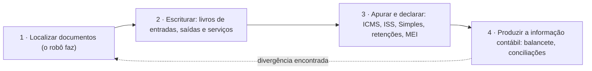
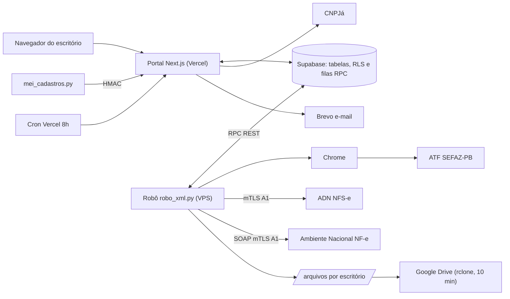

# LotiVisse XML por dentro

Documentação de apresentação do projeto, preparada para a revisão técnica do Monoblocs (situação em 26/11/2026, `main` em `23c8d51`).

- **Versão completa:** abra [`index.html`](index.html) no navegador (baixe a pasta `docs/apresentacao` inteira, com `fotos/`). Ela traz os diagramas, o fluxo de cada ferramenta do acionamento ao recebimento, as telas do portal, o mapa do código e a pauta de revisão.
- **Telas:** [`fotos/`](fotos). Capturadas do portal rodando localmente com a sessão e as empresas fictícias da suíte de testes (`web/tests/fixtures/interface-session.ts.txt`). Nenhum dado de cliente aparece.

Este resumo traz a lógica do sistema e a arquitetura, que o GitHub já mostra com os diagramas.

## Por que o sistema existe: a lógica contábil

O trabalho de um escritório contábil se resume a três entregas: **escriturar** as operações do cliente, **declarar** ao fisco o que foi escriturado e apurado, e **produzir as informações contábeis** (balancete, demonstrações, conciliações) que sustentam as decisões do cliente.

As três dependem de um passo anterior que consome boa parte do tempo da equipe fiscal: **localizar e reunir os documentos**. São notas fiscais espalhadas em portais diferentes (SEFAZ do estado, Portal Nacional da NFS-e, Ambiente Nacional da NF-e), guias, extratos e certidões que precisam ser buscados empresa por empresa, mês a mês, com o login do contador ou o certificado de cada cliente.

O LotiVisse XML automatiza esse passo. O robô faz a busca, confere de qual empresa é cada documento pelo conteúdo do XML e entrega tudo na pasta do cliente e da competência, no caminho que o sistema contábil (Domínio) importa. A equipe deixa de procurar e passa a conferir, escriturar e analisar.

| Documento que o robô traz | Para que a equipe usa | Etapa que alimenta |
|---|---|---|
| XML de NF-e de saída, NFC-e e NFS-e emitidas | Registrar as receitas e as saídas; base de cálculo do ICMS, do ISS e da receita bruta do Simples Nacional | Escrituração · apuração · PGDAS-D, EFD |
| XML de NF-e de entrada e NFS-e recebidas | Registrar compras, custos e despesas; aproveitamento de créditos quando o regime permite | Escrituração · apuração |
| CT-e (remetente e destinatário) | Fretes contratados e prestados, com o imposto destacado no conhecimento | Escrituração · apuração |
| NF-e destinadas (Monitor Fiscal) | Encontrar compras emitidas contra o CNPJ do cliente que ele não enviou ao escritório, antes do fechamento do mês | Conferência da escrituração |
| Relatório de retenções da NFS-e | ISS, IRRF, PIS, COFINS, CSLL e INSS retidos, nota a nota e em totais | Declaração das retenções (EFD-Reinf, DCTFWeb, ISS municipal) |
| Faturas (DAR em aberto) | Guias do ICMS para pagamento, enviadas ao cliente | Cumprimento da obrigação principal |
| Extrato de pagamentos | Confirmar o que foi recolhido e contabilizar o pagamento | Informação contábil · conciliação |
| Omissão e inadimplência · Certidão de débitos | Ver o que a SEFAZ aponta como pendente e comprovar a regularidade do cliente | Controle das declarações e da regularidade fiscal |
| Conferência cartão de crédito | Cruzar as vendas no cartão informadas pelas administradoras com as notas emitidas, para identificar receita sem nota | Conferência da escrituração |
| Dossiê MEI e faturamento NFS-e do MEI | Acompanhar o limite anual do MEI e antecipar o desenquadramento | Declaração anual do MEI (DASN-SIMEI) · orientação ao cliente |

O sistema localiza e organiza os documentos; a escrituração, a apuração e as declarações continuam sendo feitas e conferidas pela equipe no sistema contábil. As obrigações citadas dependem do regime e da atividade de cada cliente.

## Arquitetura

O portal e o robô nunca conversam diretamente. O portal grava o pedido no banco; o robô, num laço contínuo, chama funções do banco que reservam o próximo lote de trabalho (`for update skip locked`), executa e grava o resultado.

| Ferramenta | Acionamento | Recebimento |
|---|---|---|
| SEFAZ-PB: XML (NF-e, NFC-e, CT-e) | Agendar → SEFAZ do estado; fila `xml_pegar_lote` | ZIP do ATF por empresa e competência, total no nome da pasta, DANFE em `PDF/` |
| SEFAZ-PB: guias, certidões, Dossiê MEI | Colunas da mesma planilha | PDFs por serviço; Dossiê no painel MEI |
| NFS-e Portal Nacional | Certificados + Agendar → Portal Nacional; fila `xml_nfse_reservar_lote` | XML, DANFSe, retenções em .xlsx, lote ABRASF |
| Monitor Fiscal | Monitor Fiscal → Adicionar; consulta diária no horário do escritório | `NF-e Recebidas/` com XML e DANFE; eventos de cancelamento |
| Monitoramento MEI | Trazer MEIs cadastrados; Dossiê e NFS-e alimentam o painel | Painel por ano e alertas por e-mail |
| Entrega | Timer de 10 min na VPS | Pasta do escritório no Google Drive |

Detalhes técnicos de cada parte: [`README.md`](../../README.md), [`robo/NFSE.md`](../../robo/NFSE.md), [`robo/NFE.md`](../../robo/NFE.md), [`servidor/LEIAME.md`](../../servidor/LEIAME.md), [`web/IMPLANTACAO.md`](../../web/IMPLANTACAO.md) e [`HANDOFF.md`](../../HANDOFF.md).
